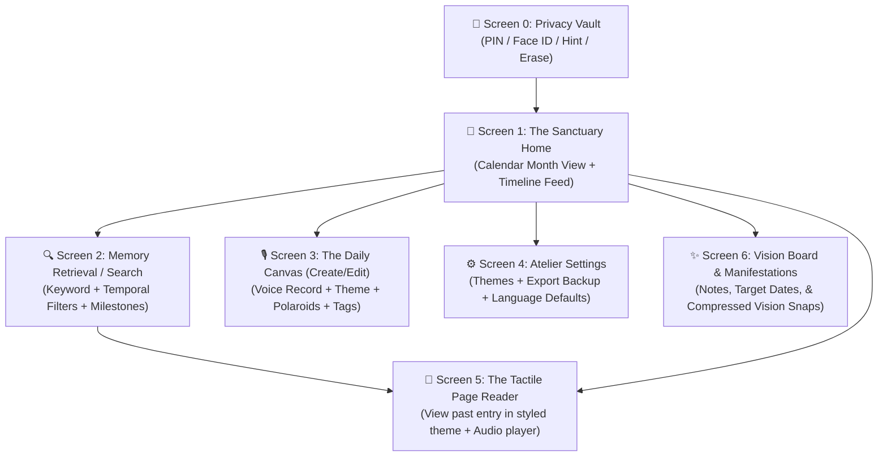
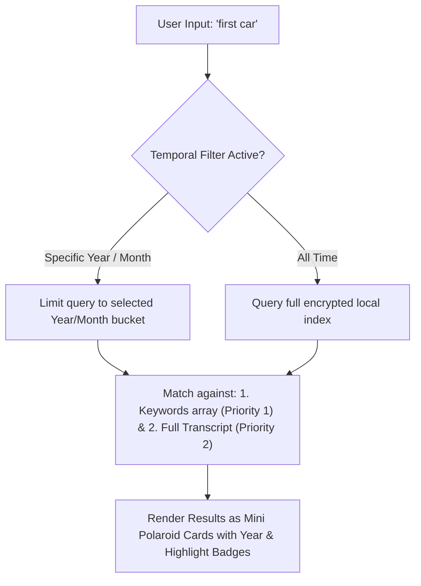

# Phase 3: Information Architecture & Taxonomy
**Project Title:** Dear Diary – The Multimodal Memory Archive  
**Creative Lead:** Laya (Fashion Communication, NIFT Hyderabad)  
**UX Focus:** Hierarchical Sitemap, Entry Data Anatomy, & Multi-Tier Search Taxonomy  

---

## 1. Global Sitemap & Navigation Schema

---

## 2. "Journal Entry" Data Anatomy & Taxonomy
Every entry stored in the local-first encrypted vault follows this schema:

| Data Field | Type | Description |
| :--- | :--- | :--- |
| `id` | String | Unique timestamp identifier (e.g. `entry_20261006_112000`) |
| `timestamp` | ISO String | Exact date and time recorded |
| `year` | Number | Year index for quick filtering (e.g. `2026`) |
| `month` | Number | Month index (e.g. `10`) |
| `language` | String | Spoken language code (e.g. `en-IN`, `ml-IN`, `hi-IN`) |
| `transcriptText` | String | Mirror-script transcribed text of the day |
| `keywords` | Array<String> | Custom user-tagged keywords (e.g. `["first car", "celebration"]`) |
| `photos` | Array<Object> | Array of Polaroid objects: `{ base64Url, caption, rotationDeg }` |
| `pageDesign` | String | Layout style: `lined`, `grid`, `dotted`, or `plain` |
| `themeId` | String | Aesthetic palette: `paper`, `ink-pen`, or pending moodboard |
| `isMilestone` | Boolean | Star toggle for major life moments (🎉 / 🌟) |
| `audioBlob` | Blob/Base64 | Optional temporary compressed voice recording |
| `isAudioPinned` | Boolean | Flag to preserve voice permanently (pinned/starred) |
| `audioExpiresAt` | ISO String | Expiry timestamp (e.g. 30–90 days from creation) |

### 2B. "Manifestation & Vision Board" Data Schema
| Data Field | Type | Description |
| :--- | :--- | :--- |
| `id` | String | Identifier (e.g. `manif_20261012_0500`) |
| `noteText` | String | Written intention/manifestation note |
| `targetDate` | String | Target date for reflection (e.g. 3 months / 1 year) |
| `createdAt` | ISO String | Creation timestamp |
| `photoUrl` | String | Optional client-side auto-compressed image thumbnail (< 100 KB) |
| `isAchieved` | Boolean | Reflection checkmark when realized |

---

## 3. Search & Retrieval Filter Matrix

---

## 4. Phase 3 Sign-Off & Stage Gate Checklist
- [x] Global sitemap defined across 5 connected screens.
- [x] Full data taxonomy and component anatomy documented.
- [x] Multi-tier search architecture mapped (Keywords + Temporal filters + Milestones).
- [ ] **Ready for Phase 4: User Flows & Low-Fidelity Wireframes.**
