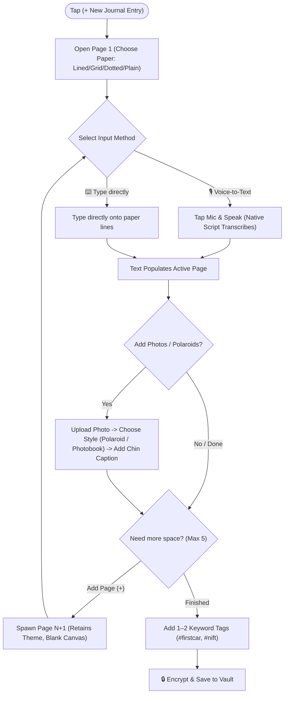

# Phase 4: User Flows & Low-Fidelity Wireframes
**Project Title:** Dear Diary – The Multimodal Memory Archive  
**Creative Lead:** Laya (Fashion Communication, NIFT Hyderabad)  
**UX Focus:** Dynamic Multi-Page Journal Architecture (1–5 Pages), Dual-Input Modality, & Screen Wireframes  

---

## 1. Core Architectural Updates

### A. Dynamic Multi-Page Pagination (1 to 5 Pages)
- **Concept:** Just like a real physical notebook, an emotional or eventful day shouldn't be squeezed into a single rigid box. 
- **Pagination Rule:** Each daily entry starts at **Page 1 (Minimum)** and can expand up to **Page 5 (Maximum)** as the user speaks, writes, or attaches more photos.
- **Page Flipping:** Visual pagination indicator (`[ Page 1 of 3 ]` with subtle corner curl or left/right swipe navigation).

### B. Dual-Input Modality: Voice-First + Tactile Keyboard
- **Mode 1 (Primary - Voice-to-Text):** Tap microphone $\rightarrow$ speak in chosen language $\rightarrow$ live transcription onto the paper lines.
- **Mode 2 (Secondary - Text-to-Text / Keyboard):** Tap directly on any line to type, correct typos, or journal quietly in public spaces like libraries or classrooms.

---

## 2. Multi-Page Creation Task Flow



---

## 3. Low-Fidelity Screen Wireframes

### Screen 0: The Privacy Vault (Lock Screen)
```text
+-------------------------------------------------------------+
|                                                             |
|                       [ 🔒 DEAR DIARY ]                     |
|                   "A sanctuary for your voice"               |
|                                                             |
|                        [ • • • • ]                          |
|                       Enter Passcode                        |
|                                                             |
|                       [ 1 ] [ 2 ] [ 3 ]                     |
|                       [ 4 ] [ 5 ] [ 6 ]                     |
|                       [ 7 ] [ 8 ] [ 9 ]                     |
|                       [ 🔑] [ 0 ] [ 👆]                     |
|                               (Face ID / Biometric)         |
|                                                             |
|                     [ Hint: First pet name ]                |
|                    [ Erase & Start Fresh... ]               |
+-------------------------------------------------------------+
```

---

### Screen 1: Sanctuary Home (Calendar & Scrapbook Feed)
```text
+-------------------------------------------------------------+
| ⚙️ Settings        [ DEAR DIARY ]           🔍 Search Memories|
+-------------------------------------------------------------+
|  [ 📅 Calendar View ]          [ 🖼️ Memory Scrapbook Feed ]  |
+-------------------------------------------------------------+
|   OCTOBER 2026                                              |
|   Su   Mo   Tu   We   Th   Fr   Sa                          |
|                  01   02   03   04                          |
|   05   06📖 07   08   09   10🎉 11                          |
|   12   13   14   15   16   17   18                          |
|   (📖 = Entry Saved   |   🎉 = Amma's Birthday)             |
+-------------------------------------------------------------+
| RECENT SCRAPBOOK PAGES                                      |
| +-------------------------+     +-------------------------+ |
| | [Polaroid: NIFT Shoot]  |     | [Polaroid: First Car]   | |
| | "Late night review..."  |     | "Finally brought it..." | |
| | Oct 06, 2026 • 2 pgs    |     | Aug 14, 2026 • 3 pgs    | |
| +-------------------------+     +-------------------------+ |
|                                                             |
|             [ (🎙️+) Start Today's Journal ]                 |
+-------------------------------------------------------------+
```

---

### Screen 2: Memory Retrieval & Keyword Search
```text
+-------------------------------------------------------------+
| ← Back                  SEARCH MEMORIES                     |
+-------------------------------------------------------------+
|  [ 🔍 Search: "first car"                              ] [X]|
+-------------------------------------------------------------+
| Time Filter:  [ All Time ]  [ 2026 ]  [ 2025 ]  [ Last Month]
| Tag Filter:   [ #milestone ]  [ #college ]  [ #celebration ]
+-------------------------------------------------------------+
| FOUND 1 ENTRY:                                              |
|                                                             |
| +---------------------------------------------------------+ |
| | 🌟 AUG 14, 2025 • 3 Pages • Malayalam & English         | |
| | Tags: #firstcar #celebration                            | |
| |                                                         | |
| | [Polaroid Snap]   "ഇന്ന് എന്റെ ആദ്യത്തെ വണ്ടി വാങ്ങി...| |
| |                   Finally drove home with my new car!   | |
| |                   Felt surreal taking parents out."     | |
| |                                     [ Open Entry → ]    | |
| +---------------------------------------------------------+ |
+-------------------------------------------------------------+
```

---

### Screen 3: The Daily Canvas & Multi-Page Studio (Create/Edit)
```text
+-------------------------------------------------------------+
| ← Close          TUESDAY, OCT 06, 2026         [ 🔒 Save ]  |
+-------------------------------------------------------------+
| Paper: [ Lined ▾ ]   Palette: [ Blossom ▾ ]   Lang: [ മലയാളം ▾]
+-------------------------------------------------------------+
| +---------------------------------------------------------+ |
| | [ < Page 1 of 2 > ]               [ + Add Page (Max 5) ]| |
| |                                                         | |
| |  =====================================================  | |
| |  ഇന്ന് കോളേജിൽ ക്രിട്ടിക് ഉണ്ടായിരുന്നു. ടീച്ചർ ഡിസൈൻ  | |
| |  കണ്ട് ഒരുപാട് അഭിനന്ദിച്ചു...                          | |
| |  -----------------------------------------------------  | |
| |  (Click anywhere to type / edit text...)                | |
| |                                                         | |
| |   +-----------------+                                   | |
| |   | [Photo Preview] |                                   | |
| |   |                 |                                   | |
| |   | "NIFT Jury Day" |  (Polaroid frame with caption)    | |
| |   +-----------------+                                   | |
| +---------------------------------------------------------+ |
|                                                             |
| Tools: [ 🎙️ Speak ]  [ ⌨️ Type ]  [ 📷 Add Photo ]  [ # Tag ]|
+-------------------------------------------------------------+
```

---

## 4. Phase 4 Sign-Off & Stage Gate Checklist
- [x] Multi-page dynamic pagination logic (1 to 5 pages per entry).
- [x] Dual-input modality (Voice-to-Text primary, Keyboard fallback).
- [x] Complete wireframe sketches for all 5 core application views.
- [ ] **Ready for Phase 5: Visual Design System & Design Tokens.**
